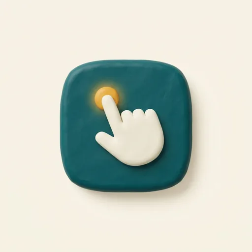

# Ishaara — اشارہ



**A lesson on your own screen, in your own language — until you don't need it.**

Ishaara is an offline phone tutor for people who did not grow up with technology. Ammi (a parent or grandparent) sends a screenshot of the screen where she is stuck. The app makes a short Urdu lesson **on her own screenshot**, shows where to tap and why, checks her next screenshot to confirm she did it herself, and gives less help each time. The AI runs on the phone. Screenshots never leave it.

> Hackathon: NED Build4Better, Codesphere 3.0 (31 Oct 2026).

---

## Team

| Name | Role |
|---|---|
| TODO | TODO |
| TODO | TODO |
| TODO | TODO |
| TODO | TODO |

---

## Target user and problem

**Primary user: "Ammi".** A Pakistani parent or grandparent, 55 to 75, with a smartphone (iPhone or Android). She reads Urdu comfortably and English weakly. She uses WhatsApp and the camera, and sometimes JazzCash. She often uses the phone one-handed, with reading glasses. Her fears are breaking something, looking foolish, bothering her children, and scams.

**The help-call loop.** She gets stuck, calls a child, the child fixes it over the phone, and the same question comes back weeks later. Her child has to explain the same screen again, and she still does not learn it.

**Evidence** (sources in RESEARCH.md; open each source before quoting):

- The most common family complaint is repeated questions. One example: a mother asked about the same customs card 15 times. ([The Spinoff, 13 May 2026](https://thespinoff.co.nz/society/13-05-2026/how-did-i-get-the-job-of-24-7-it-support-for-my-parents))
- HelpCall (CHI 2024 workshop paper) does annotated screenshots and video calls. Saving and replaying help is listed as future work. ([paper](https://www.cs.ubc.ca/~ttaa2021/content/HelpCall/CHI24WorkshopPositionPaper.pdf))
- Pakistan recorded 157,465 cybercrime complaints in 2025 (ProPakistani, 21 May 2026). Other sources give different totals, so this is one source only. ([ProPakistani](https://propakistani.pk/2026/05/21/pakistans-cybercrime-conviction-rate-stayed-below-0-04-despite-523000-complaints/))
- 28% of women who use mobile internet go online only through someone else's phone (4% of men). ([GSMA 2026, via Arab News](https://www.arabnews.pk/pakistan/pakistan-narrows-mobile-gender-gap-but-28-of-women-still-rely-on-borrowed-phones-report-2649428))

We did not find a product that saves the helper's explanation as a replayable lesson, checks the redo, and shrinks the help. Pieces exist separately (see RESEARCH.md). The combination is the claim we make.

---

## Solution and core features

**The loop**

1. Ammi shares a screenshot (or it is picked from her photos).
2. Private details (numbers, names) are hidden on the device before any analysis.
3. The app finds the target: a screen map first, then on-device vision for unmapped screens.
4. A lesson plays on her own screenshot: a 3D phone, the camera zooms to the button, a 3D finger taps, the rest of the screen dims, and an Urdu voice says what to do and why.
5. She does the step herself in the real app and sends the next screenshot.
6. The app checks that screenshot. If it matches, it says *Shabash*. If not, it gives a gentle hint.
7. The next time the same task comes up, the help is shorter: full lesson, then a glow, then "Aap ko aata hai!" (you already know this).

**Features**

| Feature | Notes |
|---|---|
| Ask by voice | Hold the mic; Whisper on the device turns Urdu speech into a task. The app shows "Aap ne kaha: …" so she can confirm. |
| Ask by picture | Task cards: Photo, Video call, Voice note, Paise bhejna (send money). |
| Chhupao (hide) | Draw over private areas before analysis. Blackout happens on the device. |
| Screen-map matching | Tesseract.js OCR reads the screen; Zod-validated screen maps give the target. |
| Florence-2 grounding | Finds buttons on screens with no map. Used only when the model is ready and confidence passes a threshold. |
| Lesson player | 3D phone, GSAP timeline, spotlight, Urdu captions, Urdu voice clips. |
| Urdu translation | Opus-MT en→ur when its ONNX build is available, with a dictionary fallback. |
| "Ab aap khud karein" | The next-screenshot check, with a 3D *Shabash* celebration or a hint. |
| Help that shrinks | Full → glow → "Aap ko aata hai!", plus a hint button. |
| OTP/PIN guard | If the screen asks for an OTP, PIN or MPIN, the app shows a calm warning and stops the lesson. |
| Meri Videos | Saved lessons on a 3D shelf (or a plain list), offline, with delete. |
| Meri Taraqqi | Ammi's progress: skills learned, help level per skill, calls saved this week. Read aloud. |
| Family dashboard | Opt-in only. The child signs in with Google and sees progress for linked elders. |
| Family se poochein | Share the screen to ask family, via Web Share (WhatsApp). |
| Bachon ko dikhayein | Progress card image, shared only when Ammi presses it. |
| Back-Tap shortcut and Dikhayein | An iPhone Back Tap Shortcut opens the app with `?from=shortcut`. The "Dikhayein" screen reads the clipboard inside a tap. |
| Judge view | Laptop layout at `/judge`: the 3D phone beside the steps, live metrics, "Try a sample". |
| Offline PWA | Installable; app shell and model files cached after first use. |
| Simple mode | Turns off 3D, uses flat animation. Also used automatically on weak devices. |
| Accessibility | Text size, high contrast, spoken instructions, 56 px+ targets, reduced-motion support. |

---

## What works and what is simulated

**Reliable:** screens with a screen map. The mapped WhatsApp flow is:

- `wa_chats`: WhatsApp chat list
- `wa_chat`: WhatsApp chat screen
- `wa_photo_picker`: choosing a photo
- `wa_photo_preview`: previewing and sending a photo

**Less reliable:** other screens use Florence-2 to find the button. This is only used when the model is downloaded and ready. If the model is not ready, or its confidence is low, the app says "ask family" instead of guessing.

**Demo data:** the files in `public/samples/` are mock WhatsApp screens drawn for the demo. They are not real screenshots.

**Voice:** Urdu voice clips are generated at build time with Meta MMS-TTS (`npm run voice:pregen`) and stored in `public/voice/`. If a clip is missing, live TTS runs in the worker; if that fails, the browser's `ur-PK` voice is used; if no voice is available, only captions show. No human recordings are used.

**Whisper Urdu accuracy varies** with accent, noise and the base vs tiny model. The app confirms what it heard.

**iPhone limits**

- iOS does not let any app read another app's screen. The user must take or share the screenshot.
- iOS Safari may not have WebGPU. The models then run on WASM, which is slower.
- Low-memory phones may need Simple mode.
- The iOS Shortcut is a manual setup (see the in-app `/setup` guide).

**Family sync** needs a Firebase config in `.env` and the Firestore rules deployed. Without them, sync is off and the rest of the app works.

**Other limits:** the app has only been tested on a small set of screens. Field testing with elders has not been done yet.

---

## Privacy and safety

**Stays on the device**

- Screenshots, redacted images, OCR text, voice, and lesson content.
- Models run in the browser. Screen-map and lesson data are bundled.
- Lessons are stored in IndexedDB. Settings are in localStorage.
- Lessons and screenshots are not encrypted at rest on the device. The user can delete everything from Settings.

**Redaction first:** the image is blacked out on the device before OCR, storage, or sharing. Re-encoding strips EXIF metadata.

**Synced only if Ammi turns it on** (off by default, explained in Urdu). Only progress is synced: skill, level, last practised, and weekly counts. Turning it off, or the "delete everything" action, removes the synced data. The Firestore rules (`firestore.rules`) also store the elder's display name and a family invite code. Screenshots, voice, lessons, and screen text are never synced.

**OTP/PIN guard:** the app detects OTP, PIN and MPIN prompts and stops the lesson with a calm warning.

**No analytics.** The app does not send usage data anywhere. Judge metrics are computed locally.

**No elder account.** Ammi never signs in. Her device joins anonymously (Firebase Anonymous Auth) and is linked to the family with a short-lived code.

**Security rules summary** (`firestore.rules`):

- Deny all by default.
- Families can be read only by their owner (the child).
- The elder document can be written only by that elder's own device, only with an allow-listed set of fields, and it cannot change `elderId` or `inviteCode`.
- Invites are created only by the family owner, expire within 30 minutes, and can be read only while unexpired. They cannot be listed or updated.

**Security review:** [docs/security/2026-10-31-round1-review.md](docs/security/2026-10-31-round1-review.md) covers the round-1 engine and UI. The result: no high or medium issues. Known low items: Google Fonts were loaded from Google (planned to self-host with `@fontsource`), and model files come from public CDNs on first use. The npm audit highs are in server-side transitive packages that are not bundled into the browser build.

---

## Tech stack and dependencies

**App** (from `package.json`)

- React 19, TypeScript (strict), Vite 8, React Router 7
- Tailwind CSS v4 (`@tailwindcss/vite`), `motion`, `gsap` with `@gsap/react`
- React Three Fiber, drei and postprocessing (3D)
- Radix UI (dialog, slider, switch, toggle), Zustand
- transformers.js (`@huggingface/transformers`), `comlink`, `tesseract.js`
- Firebase (Auth, Firestore), `qrcode.react`
- Zod (validation), `idb-keyval` (IndexedDB), `vite-plugin-pwa`
- Fonts: `@fontsource/noto-nastaliq-urdu`, `@fontsource/atkinson-hyperlegible-next`
- Tests: Vitest, Testing Library, `fake-indexeddb`, `@firebase/rules-unit-testing`, Playwright, ESLint, Prettier

**Models and data**

| Use | Model or data | Where it runs | Licence |
|---|---|---|---|
| Speech to text | Whisper `onnx-community/whisper-base` (fallback `whisper-tiny`) | Browser, worker | MIT |
| Vision (unmapped screens) | Florence-2-base-ft (`onnx-community/Florence-2-base-ft`) | Browser, worker | MIT |
| Translation en→ur | Opus-MT `Xenova/opus-mt-en-ur` (if available), then dictionary | Browser, worker; dictionary bundled | CC-BY 4.0 |
| Urdu voice | Meta MMS-TTS `mms-tts-urd-script_arabic` | Build time (clips); browser (live fallback) | CC-BY-NC 4.0 |
| OCR | Tesseract.js with `eng` and `urd` data | Browser | Apache-2.0 |

Model files are downloaded from public model hosts on first use and cached. Only the model files are downloaded; screenshots are not uploaded.

---

## Setup and run

**Prerequisites**

- Node.js 20 or newer, and npm
- Optional: [`uv`](https://docs.astral.sh/uv/) (only for regenerating the Urdu voice clips)
- Optional: a Firebase project (Spark plan) for family sync
- For `npm run test:rules`: Firebase CLI and Java (for the Firestore emulator)

**Steps**

```bash
npm install --legacy-peer-deps
cp .env.example .env        # optional: fill in the VITE_FIREBASE_* values
npm run dev
```

**Commands**

| Command | What it does |
|---|---|
| `npm run dev` | Starts the dev server |
| `npm test` | Runs the Vitest suite |
| `npm run test:rules` | Runs Firestore rules tests against the emulator |
| `npm run build` | Type-checks and builds the production app |
| `npm run voice:pregen` | Regenerates Urdu voice clips with MMS-TTS (needs `uv`) |
| `npx firebase-tools deploy --only firestore:rules --project <id>` | Deploys the security rules |

**In the app**

- `?mock` runs the app with mock services (no models or Firebase needed).
- `/judge` opens the laptop judge view.
- On desktop, "Try a sample" loads one of the mock WhatsApp screens.

---

## How we built it and AI disclosure

- **Antigravity 2.0 (Google Gemini)** built the engine (non-UI code: AI workers, OCR, screen-map matching, lesson building, check step, storage, sync, tests) in three rounds, from written task specs.
- **Claude (Anthropic)**: Opus planned the work, wrote the task specs and UI specs, defined the shared types, and reviewed each round. Haiku wrote the UI components, 3D scenes, styling, and fixes from Opus's fix lists.
- **Images** were generated with Antigravity's image model.
- **On-device models** are listed in the table above.

Every module should be explainable by a team member. Ownership:

- TODO: who owns the AI workers and models
- TODO: who owns OCR and screen maps
- TODO: who owns the lesson player and UI
- TODO: who owns sync, rules and security

---

## Credits

- Urdu voice clips: generated with Meta MMS-TTS (`facebook/mms-tts-urd-script_arabic`), CC-BY-NC 4.0.
- Fonts: Noto Nastaliq Urdu (SIL Open Font Licence), Atkinson Hyperlegible Next (SIL Open Font Licence).
- Images: generated with Antigravity (Google Gemini image model).
- Models: Whisper (MIT), Florence-2 (MIT), Opus-MT (CC-BY 4.0), Tesseract (Apache-2.0).
- Research: GuideMe (CHI 2026), HelpCall (CHI 2024), and the sources linked in RESEARCH.md.

---

## Next steps

- **Native wrapper with Capacitor** to pick up the newest screenshot automatically. iOS needs a Mac with Xcode and an Apple developer account. Android is easier.
- **Map Studio:** a family member uploads a new screenshot, taps the target, and records the Urdu voice to create a new screen map.
- **More apps:** JazzCash, the camera, and video calling.
- **Field testing** with elders and their families.

---

## Final submitted commit

TODO: `<commit hash>`
